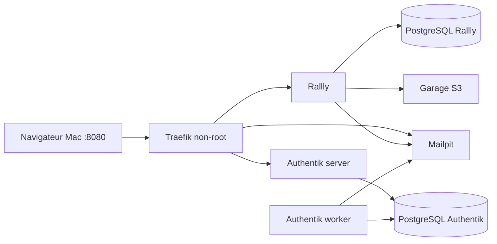

# Architecture locale

`frontend` relie le proxy, les services HTTP et le SMTP. `rallly-data` relie Rallly, sa base et Garage. `authentik-data` relie les processus Authentik et leur base. Les deux réseaux de données sont `internal: true`. Aucun port de base, S3 ou SMTP n'est publié.

Traefik porte les alias Docker `rallly.localhost`, `authentik.localhost`, `mailpit.localhost`. Le navigateur résout ces noms vers 127.0.0.1 ; les conteneurs les résolvent vers Traefik. L'URL de découverte OIDC est donc identique dans le navigateur et Rallly, sans confusion entre localhost et le réseau des conteneurs.

Traefik écoute sur 8080 en non-root, sans accès au socket Docker, sans dashboard. Le routage conserve Host et les en-têtes transmis par le proxy ; Authentik utilise son support natif du proxy et des WebSockets.

Volumes : deux bases, données Authentik partagées server/worker, métadonnées et objets Garage. Les messages Mailpit sont temporaires (tmpfs) et disparaissent à l’arrêt du conteneur. Les scripts ne suppriment aucun volume.

L'accès HTTP est réservé au laboratoire local. Une VM exige TLS, DNS, pare-feu, SMTP réel, sauvegardes et accès Mailpit restreint.
